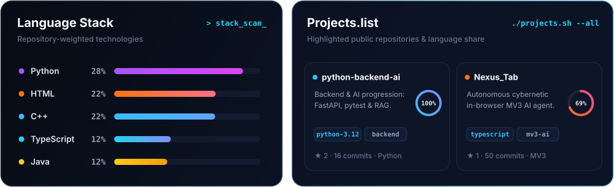

  
   
  
   
  
    
  
    <a href="https://sujoybehera.github.io/PORTFOLIO/"><b>🌐 Portfolio</b></a>
    &nbsp;·&nbsp;
    <a href="https://github.com/SujoyBehera/python-backend-ai"><b>🐍 python-backend-ai</b></a>
    &nbsp;·&nbsp;
    <a href="https://github.com/SujoyBehera/Nexus_Tab"><b>⚡ Nexus_Tab</b></a>
    &nbsp;·&nbsp;
    <a href="https://github.com/SujoyBehera/leetcode-sols"><b>⚔️ leetcode-sols</b></a>
    &nbsp;·&nbsp;
    <a href="https://linkedin.com/in/sujoy-behera-69971433b"><b>💼 LinkedIn</b></a>
    &nbsp;·&nbsp;
    <a href="mailto:beherasujoy@gmail.com"><b>✉️ Email</b></a>
  

